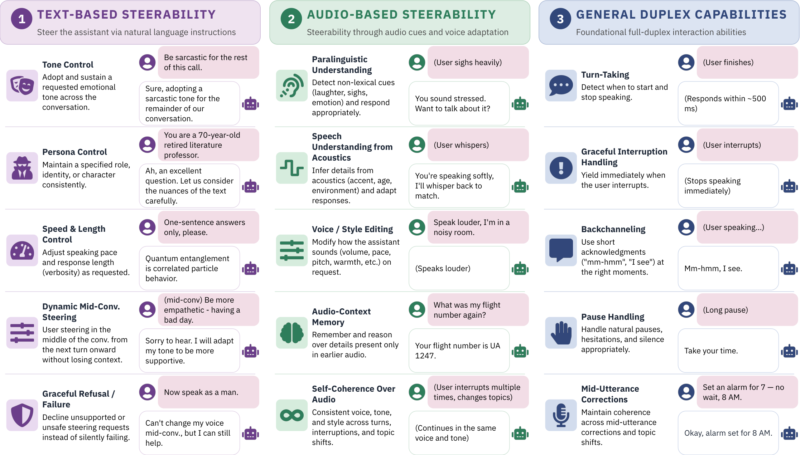

# SteerDuplex: Steerable Duplex Speech Dialogue Models

[Paper](https://arxiv.org/abs/2609.12623)



Coming soon.

- [x] **Benchmark** — [`steerbench/`](steerbench/) · [dataset on Hugging Face](https://huggingface.co/datasets/utkarsh4430/SteerBench)
- [x] **Inference code** — [`steerbench/`](steerbench/) (benchmark inference, judge and scorer)
- [ ] Checkpoint
- [ ] Training code

## Citation

```bibtex
@misc{tyagi2026steerduplexsteerableduplexspeech,
      title={SteerDuplex: Steerable Duplex Speech Dialogue Models},
      author={Utkarsh Tyagi and Ramaneswaran Selvakumar and Advait Gosai and Sonal Kumar and Nikhil Barhate and Isabell Sagar and Steven Li and Miheer Bavare and Daniel Quigley and Fabiola Tapia Carrillo and Jose M Patron E and Diego Macías Gutiérrez and Paul Song and Ramani Duraiswami and Dinesh Manocha and Yunzhong He},
      year={2026},
      eprint={2609.12623},
      archivePrefix={arXiv},
      primaryClass={cs.AI},
      url={https://arxiv.org/abs/2609.12623},
}
```
